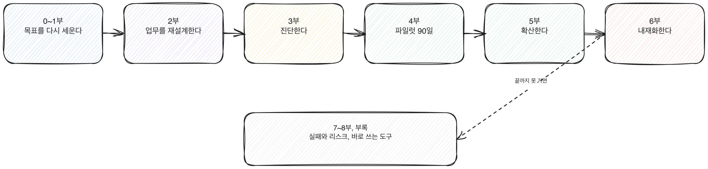

# AX 전환 매뉴얼

**AI를 최대한 활용해 회사를 실제로 바꾸는 법을 정리한 실행 매뉴얼이다.**

경영진이 "AX 전환"을 선언하는 순간과, 그 전환이 조직에 실제로 남는 순간 사이에는 큰 간극이 있다. 이 책은 그 간극을 목표 재정의, 업무 재설계, 진단, 파일럿, 확산, 내재화라는 여섯 단계로 나눠 끝까지 따라간다.

---

## 이 책에 대하여

**다섯 가지를 축으로 삼는다.**

1. **목표** — AX의 목표는 AI 사용량이 아니라 회사의 실제 성과다 (1부)
2. **재설계** — 업무를 쪼개 AI가 먼저 하고 사람이 검토, 결정하는 구조로 다시 짠다 (2부)
3. **실행** — 진단, 파일럿, 확산, 내재화를 90일 단위 로드맵으로 실행한다 (3~6부)
4. **정착** — 역할, 평가, 보상까지 바꿔야 변화가 조직에 남는다 (6부)
5. **도구** — 체크리스트, 양식, 실패 사례로 바로 쓸 수 있게 한다 (7~8부, 부록)

**실행 매뉴얼이다.** 교양서가 아니다. 각 장 끝에는 체크리스트나 바로 해볼 일을 둔다. 본문 곳곳의 `> 북마크` 표시는 나중에 다시 펼쳐 보게 되는 체크리스트, 판단 기준표, 진단 질문이다.

**지어낸 사례와 숫자를 쓰지 않는다.** 7부의 실패 사례는 전부 가상이며 매 사례 앞에 그렇게 표시했다. 출처 없는 통계나 설문 결과를 보강으로 쓰지 않는다.

형식은 마크다운이다. 깃허브에서 읽는 것을 전제로 하고 PDF는 만들지 않는다. 브라우저로 읽으려면 [웹 뷰어](https://leaf-kit.github.io/book-ax-manual/)를 연다. 저장소의 `.md` 파일을 그대로 읽어 그리므로 따로 빌드한 사본이 없고, 왼쪽 차례와 본문 검색이 붙어 있다.

---

## 한눈에 보는 구조

이 책의 아홉 부가 어떤 순서로 이어지는지 한 장의 그림으로 보면 이렇다.

[그림] 끝까지 못 가면 7~8부의 실패 사례와 도구로 돌아와 다시 짚는다.

---

## 읽는 경로

차례대로 읽지 않아도 된다. 목적에 따라 들어오는 곳이 다르다.

| 당신이 | 여기서 시작 |
|---|---|
| "AX 전환"이 구체적으로 뭘 가리키는지부터 다시 세워야 한다 | [1부 AX의 목표를 다시 정의한다](#1부--ax의-목표를-다시-정의한다) |
| AI를 어디에 붙여야 할지, 업무를 어떻게 쪼개야 할지 모른다 | [2부 업무를 다시 설계한다](#2부--업무를-다시-설계한다-ai가-먼저-사람이-검토) |
| 어디서부터 시작해야 할지, 우선순위를 못 정했다 | [3부 진단](#3부--진단-어디서부터-시작할지-찾는다) |
| 이미 파일럿을 시작했거나 시작하려 한다 | [4부 파일럿: 90일 1차 로드맵](#4부--파일럿-90일-1차-로드맵) |
| 파일럿은 끝났고 전사로 넓히는 중이다 | [5부 확산](#5부--확산-파일럿에서-전사로) |
| 확산은 됐는데 열기가 식는다, 정착이 안 된다 | [6부 내재화](#6부--내재화-조직에-정착시킨다) |
| 지금 겪는 문제가 흔한 실패 패턴인지 확인하고 싶다 | [7부 실패와 리스크 관리](#7부--실패와-리스크-관리) |
| 당장 쓸 양식과 체크리스트가 필요하다 | [8부 바로 쓰는 도구 모음](#8부--바로-쓰는-도구-모음) → [부록](#부록) |
| 모르는 용어가 나온다 | [부록 C 용어집](appendix/c-glossary.md) |

---

## 차례

### 0부 — 들어가며

- [0.1 이 책이 다루는 것과 다루지 않는 것](part0/01-scope.md)
- [0.2 AX가 실패하는 가장 흔한 이유: 목표를 잘못 세운다](part0/02-why-ax-fails.md)
- [0.3 이 책을 읽는 법](part0/03-how-to-read.md)

### 1부 — AX의 목표를 다시 정의한다

- [1.1 AX란 무엇인가: DX와 무엇이 다른가](part1/01-definition.md)
- [1.2 "AI를 많이 쓴다"는 착시: 사용량 지표의 함정](part1/02-usage-illusion.md)
- [1.3 회사가 실제로 봐야 하는 성과 지표](part1/03-real-metrics.md)
- [1.4 AX 성숙도 모델: 조직 단위](part1/04-maturity-model.md)
- [1.5 흔한 AX 오해들](part1/05-misconceptions.md)
- [1.6 AX를 선언하기 전에 답해야 할 질문들](part1/06-before-you-declare.md)

### 2부 — 업무를 다시 설계한다: AI가 먼저, 사람이 검토

- [2.1 업무를 쪼개는 법: 작업 단위로 분해하기](part2/01-decompose-work.md)
- [2.2 AI-먼저 구조란 무엇인가](part2/02-ai-first-structure.md)
- [2.3 어떤 업무가 AI-먼저에 적합한가: 판단 기준](part2/03-fit-criteria.md)
- [2.4 검토와 결정권을 사람에게 남기는 설계](part2/04-human-review.md)
- [2.5 업무 유형별 재설계 패턴](part2/05-redesign-patterns.md)
- [2.6 재설계 후 생기는 새로운 위험과 대응](part2/06-new-risks.md)

### 3부 — 진단: 어디서부터 시작할지 찾는다

- [3.1 전사 업무 매핑](part3/01-work-mapping.md)
- [3.2 AX 적합도 진단 매트릭스](part3/02-fit-matrix.md)
- [3.3 조직 준비도 진단](part3/03-readiness.md)
- [3.4 우선순위를 정하는 법](part3/04-prioritization.md)
- [3.5 진단 결과를 보고서로 만드는 법](part3/05-diagnosis-report.md)
- [3.6 진단 단계에서 흔히 하는 실수](part3/06-diagnosis-mistakes.md)

### 4부 — 파일럿: 90일 1차 로드맵

- [4.1 파일럿을 설계하는 법](part4/01-pilot-design.md)
- [4.2 90일 로드맵의 구조](part4/02-90day-structure.md)
- [4.3 파일럿 1~30일: 준비와 착수](part4/03-days-1-30.md)
- [4.4 파일럿 31~60일: 실행과 조정](part4/04-days-31-60.md)
- [4.5 파일럿 61~90일: 측정과 판단](part4/05-days-61-90.md)
- [4.6 파일럿 실패 신호를 조기에 읽는 법](part4/06-early-failure-signals.md)

### 5부 — 확산: 파일럿에서 전사로

- [5.1 확산 여부를 가르는 기준](part5/01-scale-criteria.md)
- [5.2 2차, 3차 90일 사이클 설계](part5/02-second-third-cycle.md)
- [5.3 부서 간 전파: 저항을 다루는 법](part5/03-cross-dept.md)
- [5.4 공통 인프라와 거버넌스 세우기](part5/04-shared-infra-governance.md)
- [5.5 확산 속도를 조절하는 법](part5/05-pace-control.md)
- [5.6 확산 단계의 커뮤니케이션 전략](part5/06-communication.md)

### 6부 — 내재화: 조직에 정착시킨다

- [6.1 내재화란 무엇인가: 왜 끝까지 가야 하는가](part6/01-why-internalize.md)
- [6.2 역할을 다시 정의한다](part6/02-role-redesign.md)
- [6.3 평가지표를 바꾸는 법](part6/03-kpi-redesign.md)
- [6.4 보상 구조에 AX를 반영하는 법](part6/04-compensation.md)
- [6.5 채용 기준을 바꾸는 법](part6/05-hiring.md)
- [6.6 교육과 온보딩을 다시 짠다](part6/06-training-onboarding.md)
- [6.7 리더십의 역할](part6/07-leadership.md)
- [6.8 내재화가 끝났다는 것을 어떻게 아는가](part6/08-internalization-done.md)

### 7부 — 실패와 리스크 관리

- [7.1 AX 전환이 실패하는 전형적인 경로](part7/01-failure-paths.md)
- [7.2 가상 사례로 보는 실패 1: 목표를 잘못 세운 경우](part7/02-case-wrong-goal.md)
- [7.3 가상 사례로 보는 실패 2: 파일럿에서 멈춘 경우](part7/03-case-stuck-pilot.md)
- [7.4 가상 사례로 보는 실패 3: 내재화 없이 확산한 경우](part7/04-case-scale-without-internalize.md)
- [7.5 리스크와 거버넌스: 넘지 말아야 할 선](part7/05-risk-governance.md)

### 8부 — 바로 쓰는 도구 모음

- [8.1 90일 로드맵 양식 작성법](part8/01-roadmap-template-guide.md)
- [8.2 업무 분해 워크시트 사용법](part8/02-work-breakdown-worksheet.md)
- [8.3 파일럿 평가 스코어카드 사용법](part8/03-pilot-scorecard.md)
- [8.4 전사 체크리스트 사용법 총정리](part8/04-checklist-summary.md)
- [8.5 1년을 넘어서: AX 전환 다음 단계](part8/05-beyond-one-year.md)

### 부록

- [A. 90일 로드맵 템플릿 전체](appendix/a-roadmap-template.md)
- [B. 체크리스트, 양식 전체 모음](appendix/b-forms-checklists.md)
- [C. 용어집](appendix/c-glossary.md)
- [D. 참고 자료와 더 읽을 것](appendix/d-references.md)

---

## 구성

55장(본문 51장 + 부록 4편), 종이책 기준 약 220~250쪽.

| 부 | 장 | 다루는 것 |
|---|---|---|
| 0부 | 3 | 이 책의 범위, AX가 실패하는 가장 흔한 이유, 읽는 법 |
| 1부 | 6 | AX의 정의, 사용량 착시, 실제 성과 지표, 성숙도 모델, 오해, 선언 전 질문 |
| 2부 | 6 | 업무 분해, AI-먼저 구조, 적합 기준, 사람의 검토권, 재설계 패턴, 새로운 위험 |
| 3부 | 6 | 업무 매핑, 적합도 매트릭스, 준비도 진단, 우선순위, 보고서 작성, 흔한 실수 |
| 4부 | 6 | 파일럿 설계, 90일 구조, 1~30일, 31~60일, 61~90일, 실패 신호 조기 포착 |
| 5부 | 6 | 확산 기준, 2, 3차 사이클, 부서 간 전파, 공통 인프라, 속도 조절, 커뮤니케이션 |
| 6부 | 8 | 내재화 — 역할, 평가지표, 보상, 채용, 교육, 리더십, 완료 기준 |
| 7부 | 5 | 실패 경로, 가상 사례 3편, 리스크와 거버넌스 |
| 8부 | 5 | 양식과 스코어카드 사용법, 체크리스트 총정리, 1년 이후 |
| 부록 | 4 | 90일 로드맵 템플릿, 체크리스트 양식 모음, 용어집, 참고 자료 |

## 이 책이 하지 않은 것

정직하게 적어 둔다.

| 항목 | 상태 |
|---|---|
| 특정 기업의 비공개 사례, 수치 인용 | **하지 않았다** — 7부의 사례는 전부 가상이며 매 사례 앞에 표시했다 |
| 설문이나 통계로 뒷받침한 수치 제시 | 하지 않았다 — 본문에 등장하는 숫자는 90일, 3단계 사이클처럼 이 책이 설계한 구조에서 나온 것이다 |
| 특정 AI 도구나 벤더 추천 | 하지 않았다 — 도구 선택은 조직마다 다르다고 보고 구조와 기준만 다룬다 |

## 저작권

leaf meta가 쓰고 무료로 공개한다. 출판사를 거치지 않는다.
