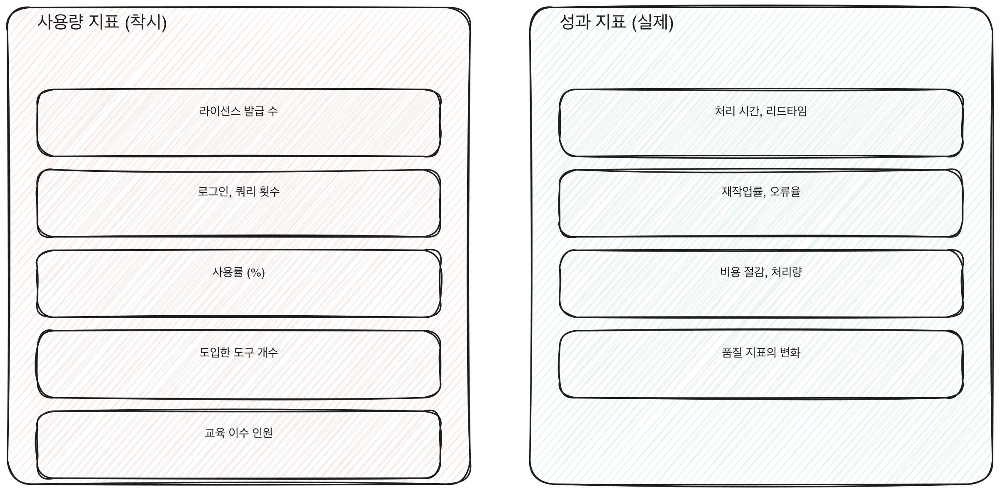

# 1.3 회사가 실제로 봐야 하는 성과 지표

1.2에서 사용량 지표가 왜 성과를 보장하지 않는지 다뤘다. 그럼 무엇을 봐야 하는가. 답은 어렵지 않다. AI를 쓰기 전부터 회사가 이미 보고 있던 지표를 그대로 쓴다. 비용, 처리 시간, 품질, 리드타임, 재작업률. AX가 성과를 냈다면 이 지표들이 움직인다. 안 움직였다면 사용량이 얼마나 높든 성과는 없었던 것이다.

[그림] 왼쪽은 빨리 오르지만 착시이고, 오른쪽은 느리게 움직이지만 실제로 바뀐 것이다.

## 다섯 가지 축

**비용.** 같은 결과물을 만드는 데 드는 비용이 줄었는가. 인건비뿐 아니라 외주비, 도구 사용료까지 포함해서 본다. AI 도구 자체의 라이선스 비용이 추가되는 걸 잊고 "비용이 줄었다"고 말하면 실제로는 전체 비용이 늘었을 수 있다.

**처리 시간.** 업무 하나를 시작해서 끝낼 때까지 걸리는 시간이 줄었는가. 여기서 중요한 건 "AI가 답을 주는 시간"이 아니라 "사람이 그 답을 검토하고 승인까지 가는 전체 시간"이다. AI가 초안을 1분에 만들어도 사람이 그걸 검토하는 데 기존보다 더 오래 걸리면 전체 처리 시간은 늘어난다.

**품질.** 결과물의 오류율, 반려율, 고객 불만 건수 같은 지표가 나빠지지 않았는가. AX 초기에는 속도를 올리려다 품질이 떨어지는 경우가 흔하다. 품질 지표를 따로 추적하지 않으면 속도가 오른 것만 보고 품질 하락을 놓친다.

**리드타임.** 요청이 들어온 순간부터 최종 결과물이 나가는 순간까지 걸리는 전체 시간이다. 처리 시간과 비슷해 보이지만, 리드타임은 대기 시간까지 포함한다. AI가 작업 자체는 빨리 끝내도 검토자의 승인을 기다리는 대기 시간이 길면 리드타임은 줄지 않는다.

**재작업률.** 한 번에 승인되지 않고 다시 손을 대야 하는 비율이다. AI가 만든 초안의 품질이 낮으면 재작업률이 오히려 올라간다. 이 지표가 오르는데 사용량만 보고 있으면 문제를 놓친다.

이 다섯 지표는 서로 당기는 관계에 있을 때가 많다. 처리 시간을 줄이려고 검토 단계를 줄이면 품질과 재작업률이 나빠질 수 있고, 품질을 지키려고 검토 단계를 늘리면 리드타임이 늘어난다. 그래서 다섯 지표 중 하나만 떼어서 "좋아졌다"고 말하는 보고도 주의해서 봐야 한다. 처리 시간이 줄었다는 보고를 받으면 같은 기간 재작업률과 품질 지표가 어떻게 움직였는지 같이 확인하는 게 맞다.

[그림] 비용, 처리시간, 품질, 리드타임, 재작업률이 움직여야 성과다.

## 사용량 지표를 성과 지표로 바꾸는 법

기존에 사용량만 보고하던 조직이 성과 지표로 옮겨가려면 세 단계를 거친다.

첫째, 지금 AI가 쓰이는 업무를 하나 골라서 그 업무에 AI가 없던 시절의 비용, 처리 시간, 품질, 리드타임, 재작업률을 먼저 확인한다. 기준점이 없으면 나중에 뭐가 좋아졌는지 비교할 수 없다. 많은 조직이 이 기준점을 남기지 않고 도입부터 서둘러서, 몇 달 뒤 효과를 입증하려 해도 비교할 과거 숫자가 없다.

둘째, 같은 업무에서 AI 도입 이후 같은 다섯 지표를 다시 측정한다. 이때 사용량도 같이 기록해 둔다. 사용량과 성과 지표를 나란히 놓으면 둘 사이에 실제로 상관이 있는지 눈으로 확인할 수 있다.

셋째, 다섯 지표 중 이 업무에 가장 중요한 한두 개를 골라 보고의 1면에 올린다. 사용량은 참고 수치로 뒤로 보낸다. 보고의 순서를 바꾸는 것만으로도 조직 안에서 "무엇이 성공의 기준인가"에 대한 인식이 바뀐다.

이 세 단계를 한 업무에서 한 번 해보면, 다른 업무로 확장할 때 드는 수고가 크게 줄어든다. 측정 체계와 보고 양식을 한 번 만들어두면 다음 업무는 그 틀에 숫자만 채우면 되기 때문이다. 반대로 매번 다른 방식으로 측정하면 업무 간 비교가 안 되고, 어느 업무에 우선적으로 투자할지 판단할 근거도 쌓이지 않는다. 이 우선순위 판단은 3부에서 다루는 진단 단계로 이어진다.

> **북마크**
> 업무 하나를 고를 때 점검할 성과 지표 다섯 가지와 기준점 확보 여부.
> - 비용: AI 도입 전 비용을 기록해 두었는가
> - 처리 시간: 작업 시작부터 승인까지 전체 시간을 재는가, AI 응답 시간만 재는가
> - 품질: 오류율, 반려율을 AI 도입 전후로 비교할 수 있는가
> - 리드타임: 대기 시간까지 포함해서 재는가
> - 재작업률: 한 번에 승인되지 않는 비율을 따로 집계하는가

## 체크리스트

- [ ] AX가 적용된 업무 중 하나를 골라 다섯 지표의 도입 전 기준점을 확보했는가
- [ ] 사용량 지표와 성과 지표를 같은 보고서에 나란히 놓아 상관관계를 확인했는가
- [ ] 다음 보고의 1면에 올릴 성과 지표를 하나 이상 정했는가
