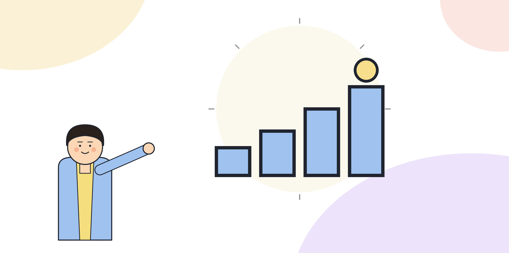

# 1.4 AX 성숙도 모델: 조직 단위

AX 전환이 조직 안에서 어디까지 와 있는지 가늠할 기준이 없으면, 모두가 "하고 있다"고 말하면서도 가리키는 상태가 전혀 다를 수 있다. 어떤 팀은 몇 명이 개인적으로 AI 도구를 쓰는 걸 두고 전환이 진행 중이라 말하고, 어떤 팀은 업무 전체를 재설계한 걸 두고 같은 말을 한다. 이 책은 조직 단위의 성숙도를 네 단계로 나눠서 쓴다. 이 단계는 2부부터 6부까지 이어지는 구조와 그대로 맞물린다.

## 네 단계

**1단계. 개별 실험.** 개인이나 소수가 자기 업무에 AI 도구를 가져와 써보는 단계다. 공식적인 지원이나 가이드라인은 없고, 쓰는 사람과 안 쓰는 사람의 격차가 크다. 성과는 개인 단위로만 나타나고 조직 전체 지표에는 드러나지 않는다. 이 단계에서는 사용량 지표가 유일하게 관찰 가능한 신호다. 1.2에서 다룬 함정이 가장 크게 작동하는 단계이기도 하다.

**2단계. 팀 단위 적용.** 특정 팀이나 부서가 업무 중 일부를 공식적으로 AI를 쓰는 방식으로 바꾼다. 아직 업무 전체를 재설계한 건 아니고, 기존 업무 순서 중 한두 단계에 AI를 끼워 넣는 수준이다. 이 단계에서 3부의 진단과 4부의 파일럿이 시작된다. 파일럿이 성공하면 3단계로, 실패하면 1단계로 되돌아가거나 멈춘다.

**3단계. 프로세스 재설계.** 업무 전체를 "AI가 먼저 처리하고 사람이 검토"하는 구조로 다시 짠 단계다. 2부에서 다루는 재설계가 이 단계의 핵심이다. 이 단계부터는 성과 지표(비용, 처리 시간, 품질, 리드타임, 재작업률)가 조직 전체 수준에서 측정 가능해진다. 5부에서 다루는 확산이 이 단계와 다음 단계 사이를 잇는다.

**4단계. 거버넌스와 내재화.** 재설계된 프로세스가 특정 담당자에 의존하지 않고, 역할 정의, 평가 지표, 보상 구조, 채용 기준에 반영되어 조직에 자리 잡은 단계다. 6부에서 다루는 내재화가 이 단계를 설명한다. 이 단계에 도달하면 담당자가 바뀌어도 전환이 유지된다.

[그림] 한 단계씩 밟지 않으면 다음 단계에서 반드시 무너진다.

## 단계 사이를 건너뛸 수 없는 이유

1단계에서 바로 3단계로 가고 싶은 유혹이 있다. 개별 실험에서 효과를 본 도구를 보고, 팀 단위 적용과 검증을 거치지 않고 곧장 업무 전체 재설계로 넘어가려는 식이다. 이렇게 건너뛰면 2단계에서 쌓였어야 할 정보, 즉 이 업무가 재설계에 적합한지, 어느 단계에서 사람의 검토가 필요한지에 대한 근거가 없는 채로 설계를 확정하게 된다. 설계가 틀렸다는 사실은 보통 3단계에 가서야, 즉 비용을 더 들인 뒤에야 드러난다. 2단계의 파일럿은 느려 보여도 이 비용을 줄이는 장치다.

반대로 4단계에서 멈추지 않고 역행하는 조직도 있다. 3단계까지 와서 성과를 냈는데, 그 성과를 낸 직원의 평가 기준은 여전히 과거 방식의 처리량으로 매겨지는 경우다. 이 경우 직원 입장에서는 재설계된 업무 방식을 쓸 이유가 평가에 반영되지 않으니, 시간이 지나면 조용히 예전 방식으로 돌아간다. 성숙도 단계는 프로세스의 설계만으로 고정되지 않고, 그 설계를 뒷받침하는 평가와 보상이 따라와야 유지된다.

## 단계는 되돌아갈 수 있다

이 모델은 한 방향으로만 올라가는 계단이 아니다. 3단계에 있던 업무도 담당자가 바뀌거나 조직 개편이 있으면 2단계로 되돌아갈 수 있다. 4단계에 도달했다고 해도 평가 지표나 보상 구조가 다시 예전 방식으로 돌아가면 조직은 눈에 보이지 않게 3단계로 퇴보한다. 그래서 어느 단계에 도달했는지보다, 그 단계를 유지하는 장치가 있는지를 더 중요하게 본다.

또한 조직 전체가 같은 단계에 있는 경우는 드물다. 어떤 부서는 3단계, 어떤 부서는 1단계에 머물 수 있다. 이 모델은 조직 전체에 하나의 점수를 매기는 용도가 아니라, 업무 하나하나, 부서 하나하나의 현재 위치를 짚어보는 용도로 쓴다.

> **북마크**
> 업무나 부서 단위로 현재 단계를 가르는 질문.
> - 공식적인 가이드라인 없이 개인이 알아서 쓰는가 → 1단계
> - 팀 단위로 업무 중 일부 단계에 AI를 쓰기로 정했는가, 아직 전체 재설계는 아닌가 → 2단계
> - 업무 전체가 AI 우선, 사람 검토 구조로 다시 짜여 있는가 → 3단계
> - 역할, 평가, 보상, 채용에 이 구조가 반영되어 담당자가 바뀌어도 유지되는가 → 4단계

## 체크리스트

- [ ] 조직 안의 주요 부서나 업무별로 현재 성숙도 단계를 매겨 보았는가
- [ ] 3단계 이상에 도달한 업무가 평가, 보상 구조와 연결되어 있는지 확인했는가
- [ ] 단계가 퇴보한 업무가 있다면 그 원인(담당자 교체, 조직 개편 등)을 짚어보았는가
