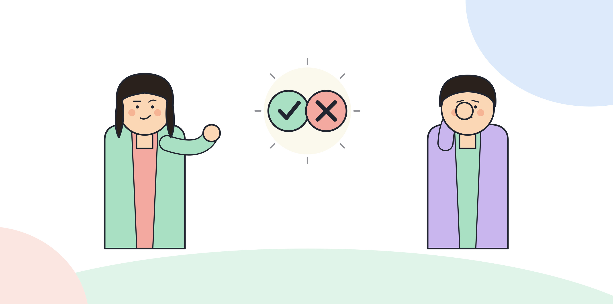

# 1.5 흔한 AX 오해들

AX 전환을 추진하다 보면 몇 가지 생각이 반복해서 등장한다. 그럴듯하게 들리지만, 따라가면 전환을 멈추게 만드는 생각들이다. 세 가지를 짚는다.

## 오해 1. AI 도구만 깔면 끝난다

이 오해는 AX를 DX처럼 취급하는 데서 나온다. 전자 결재 시스템을 깔면 전자 결재 전환은 끝난다. 접속 계정을 나눠주고 사용법을 교육하면 그걸로 할 일이 끝난다. AX는 다르다. 도구를 설치하고 계정을 배포하는 건 전환의 시작점일 뿐이다. 그 도구가 실제 업무의 판단과 수행 루프 안에 들어가려면 업무 자체를 재설계해야 한다. 어느 단계를 AI에 맡기고 어느 단계를 사람이 검토할지 정하는 작업이 빠지면, 도구는 깔려 있어도 아무도 업무 방식을 바꾸지 않는다. 1.1에서 다룬 DX와 AX의 차이가 여기서 다시 드러난다. 도구 설치는 통로를 만드는 일이고, 그 통로로 무엇이 오가는지 정하는 건 별도의 설계 작업이다.

이 오해가 오래가는 이유는 도구 도입 시점에 사용량이라는 숫자가 바로 나오기 때문이다. 배포 완료, 접속률, 사용 건수는 도입 다음 날부터 측정된다. 반면 업무 재설계의 효과는 몇 주, 몇 달이 지나야 성과 지표로 드러난다. 그래서 당장 보여줄 숫자가 필요한 보고 자리에서는 도구 도입 자체를 성과로 포장하기 쉽고, 그 포장이 반복되면 "도구를 깔았으니 끝났다"는 인식이 조직 안에 자리 잡는다.

[그림] 도구를 깔았다는 것과 전환이 일어났다는 것은 다른 문장이다.

## 오해 2. 저항은 교육이 부족해서다

AI 도구 사용에 대한 저항이 생기면 흔히 "사용법을 더 가르치면 해결된다"고 판단한다. 교육이 부족해서 생기는 저항도 분명 있다. 하지만 저항의 더 흔한 원인은 다른 데 있다. 업무가 재설계되면서 그 업무를 하던 사람의 역할이나 판단 권한이 줄어드는데, 그 변화에 대한 설명이나 합의가 없었던 경우다. 이 경우 사용법 교육을 더 해도 저항은 줄지 않는다. 오히려 "내 역할이 줄어드는 걸 더 잘 쓰라고 강요받는다"는 반감으로 번질 수 있다. 저항이 보이면 먼저 물어야 할 질문은 "이 사람이 AI를 못 써서 저항하는가, 아니면 이 재설계가 이 사람의 역할을 어떻게 바꾸는지가 불분명해서 저항하는가"다. 후자라면 교육이 아니라 역할 재설계에 대한 설명과 합의가 필요하다. 이 문제는 6부에서 다루는 역할 재설계와 바로 연결된다.

## 오해 3. 모든 업무에 AI를 먼저 두는 구조를 똑같이 적용할 수 있다

"AI가 먼저 하고 사람이 검토한다"는 구조가 한 업무에서 효과를 내면, 그 구조를 조직 전체 업무에 그대로 복제하고 싶어진다. 하지만 이 구조가 모든 업무에 똑같이 맞는 건 아니다. 반복적이고 판단 기준이 명확한 업무는 이 구조에 잘 맞는다. 반면 판단 기준 자체가 모호하거나, 한 번의 실수가 되돌리기 어려운 결과를 낳는 업무는 AI가 먼저 처리하는 구조를 적용하기 전에 더 신중한 검토가 필요하다. 어떤 업무가 이 구조에 맞는지 판단하는 기준은 2부 2.3에서 다룬다. 지금 짚을 건, "효과가 있었다"는 사실 하나만으로 전체 적용을 결정하지 않는다는 것이다.

복제 욕구가 생기는 건 자연스럽다. 한 업무에서 성과가 보이면 같은 틀을 다른 업무에 그대로 얹는 게 가장 빠른 확산처럼 보인다. 하지만 업무마다 판단 기준의 명확성, 실수의 되돌림 가능성, 검토에 드는 비용이 다르다. 예를 들어 이런 조직을 가정하면, 정형화된 양식의 데이터 입력 검증에는 이 구조가 잘 맞았지만, 같은 틀을 고객 응대 중 예외 상황 판단에 그대로 적용하면 AI가 먼저 내놓은 판단을 사람이 충분히 검토하지 못한 채 넘어가는 지점이 생길 수 있다. 구조가 같다고 적합성까지 같은 건 아니다.

> **북마크**
> 이 세 가지 오해가 지금 조직에서 작동하고 있는지 확인하는 질문.
> - 도구 도입 이후 "다음에 할 일"이 정해져 있는가, 아니면 도구 배포로 계획이 끝나 있는가
> - 저항이 보이는 지점에서 "사용법을 모른다"와 "역할이 불분명하다"를 구분해서 물어봤는가
> - 한 업무에서 성공한 재설계 구조를 다른 업무에 적용하기 전에 그 업무의 성격을 따로 점검했는가

## 체크리스트

- [ ] 도구 도입 이후의 업무 재설계 계획이 실제로 문서화되어 있는지 확인했는가
- [ ] 최근에 발생한 저항 사례 하나를 골라 원인이 교육 부족인지 역할 불명확인지 다시 짚어보았는가
- [ ] 성공한 재설계 구조를 다른 업무에 적용하기 전에 적합성 판단 기준(2부 2.3)을 참고할 계획을 세웠는가
