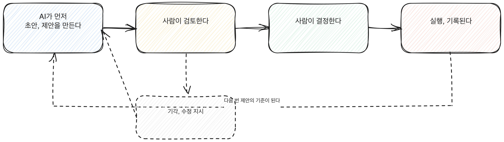

# 2.2 AI-먼저 구조란 무엇인가

AI-먼저 구조는 한 문장으로 정리된다. AI가 먼저 초안이나 제안을 만들고, 사람이 그것을 검토해서 승인하거나 고치거나 되돌린다. 순서가 고정되어 있다는 점이 핵심이다. 사람은 빈 화면에서 시작하지 않고, AI가 만든 결과물을 보면서 시작한다.

[그림] 기각이나 수정 지시는 다시 AI의 다음 제안으로 들어간다.

## 사람이 개입하는 자리가 아니라 순서를 정하는 것

"Human-in-the-loop"라는 말은 넓다. 사람이 AI가 하기 전에 승인하는 구조도, AI가 실시간으로 일하는 걸 사람이 감독하는 구조도, AI가 끝낸 뒤 사람이 결과를 고치는 구조도 전부 이 말에 들어간다. 사람이 어딘가에 있다는 것만 보장할 뿐, 어디에 있는지는 말하지 않는다.

AI-먼저 구조는 그중 한 가지 배치를 못박는다. 순서가 AI, 그다음 사람으로 고정된다. 사람이 먼저 지시하고 AI가 실행한 뒤 결과만 확인하는 구조도 아니고, AI가 일하는 동안 사람이 옆에서 지켜보는 구조도 아니다. 트리거가 발생하면 AI가 먼저 초안이나 제안을 내놓고, 그 결과가 사람 앞에 검토 대상으로 도착한다. 사람의 첫 행동은 쓰는 것이 아니라 보는 것이다.

이 구분이 왜 중요한가. "사람이 개입한다"는 설계는 개입이 언제, 어떤 형태로 일어나는지를 정하지 않으면 운영 중에 흐트러진다. 바쁠 때는 검토가 뒤로 밀리고, 급할 때는 AI 결과에 승인 버튼만 누르는 일로 줄어든다. AI-먼저 구조는 "초안은 항상 AI가 먼저 만든다"는 순서와 "그 초안은 사람의 승인 전에는 최종본이 아니다"는 상태를 같이 고정해서, 개입이 매번 같은 자리에서 일어나게 만든다.

[그림] 순서를 고정해야 바쁠 때도 검토가 뒤로 밀리지 않는다.

## 구조를 이루는 세 요소

AI-먼저 구조가 성립하려면 세 가지가 있어야 한다.

1. **초안의 지위** — AI가 만든 결과물은 완성본이 아니라 검토 대상이라는 표시가 있어야 한다. 이 표시가 없으면 사람은 자기도 모르게 AI의 결과를 최종본처럼 다룬다.
2. **검토의 행동** — 검토가 "읽었다"로 끝나지 않고 승인, 수정, 반려 중 하나로 끝나야 한다. 세 번째 행동이 한 번도 나오지 않는다면 검토가 아니라 통과 절차다.
3. **최종화의 주체** — 결과를 최종본으로 바꾸는 행동은 사람이 한다. AI는 몇 번을 다시 만들어도 그 결과를 확정하지 않는다.

> **북마크 — AI-먼저 구조인지 판별하는 질문**
> - [ ] 이 업무에서 첫 결과물을 만드는 쪽이 AI인가, 사람인가
> - [ ] 그 결과물에 검토 대상이라는 표시나 상태가 있는가
> - [ ] 검토 끝에 승인, 수정, 반려 중 하나가 기록으로 남는가
> - [ ] 결과를 최종본으로 바꾸는 행동을 사람이 하는가

## 가정으로 비교하는 세 가지 배치

같은 업무, 예를 들어 주간 업무 보고서를 작성하는 일을 가정하고 세 가지 배치를 비교하면 차이가 분명해진다.

- **사람이 먼저, AI가 다듬는 구조.** 사람이 초안을 쓰고 AI에게 문장을 정리해 달라고 맡긴다. 시작하는 부담은 그대로 사람에게 남는다.
- **AI가 끝까지, 사람이 나중에 훑어보는 구조.** AI가 보고서를 완성해서 바로 전달하고, 사람은 나간 뒤에야 확인한다. 검토가 사전이 아니라 사후이고, 틀린 내용은 이미 전달된 다음에야 발견된다.
- **AI-먼저 구조.** AI가 초안을 만들어 검토 대기 상태로 올리고, 사람이 승인해야만 보고서가 나간다. 시작하는 부담은 사람에게서 빠지고, 틀린 내용을 거르는 책임은 사람에게 남는다.

세 배치 모두 "AI와 사람이 같이 일한다"고 설명할 수 있지만, 실제로 일이 돌아가는 방식과 리스크가 걸리는 자리는 전혀 다르다. AI-먼저 구조라는 이름을 쓰는 이유는 이 차이를 매번 풀어서 설명하지 않고 한 단어로 가리키기 위해서다.

## 모든 업무에 적용되는 틀이 아니다

구조를 정의했다고 해서 모든 업무에 똑같이 적용할 수 있는 것은 아니다. 어떤 업무는 AI가 초안을 만드는 것 자체가 리스크이고, 어떤 업무는 검증할 기준이 없어서 사람이 검토해도 무엇을 보는지 알 수 없다. 어떤 업무에 이 구조가 맞는지는 2.3에서 반복성, 검증 가능성, 리스크 수준, 데이터 가용성이라는 기준으로 가른다. 여기서는 구조 자체를 정의하는 데 집중한다.

## 구조 선택과 성숙도는 다른 질문이다

1부에서 다룬 AX 성숙도 모델은 조직이 전체적으로 얼마나 멀리 왔는지를 본다. AI-먼저 구조는 업무 하나를 어떤 순서로 짤지 정하는 설계 결정이다. 성숙도가 높은 조직이라도 특정 업무는 AI-먼저 구조로 짜지 않는 쪽이 맞을 수 있고, 이제 막 시작한 조직도 적합한 업무 한 곳에서는 AI-먼저 구조를 바로 적용할 수 있다. 두 질문을 섞으면 "우리는 아직 준비가 안 됐으니 전부 사람이 먼저 한다"거나 "우리는 이미 성숙했으니 전부 AI가 먼저 한다"는 식으로 업무 하나하나의 성격을 보지 않고 조직 수준의 답을 그대로 끌어다 쓰게 된다. 구조는 업무별로 따로 판단한다.

## 체크리스트

- [ ] AI-먼저 구조와 느슨한 Human-in-the-loop의 차이를 구분해서 설명할 수 있다
- [ ] 우리 업무에서 초안은 검토 대상이라는 표시가 실제로 있는지 확인했다
- [ ] 검토 끝에 승인, 수정, 반려가 기록으로 남는 과정인지 점검했다
