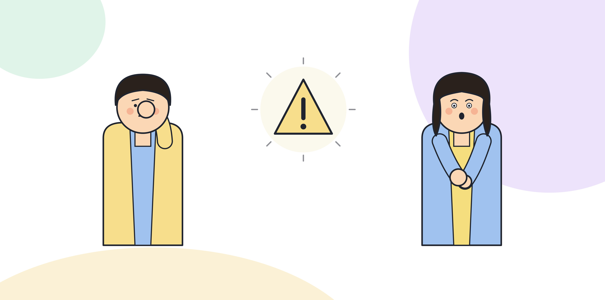

# 2.6 재설계 후 생기는 새로운 위험과 대응

AI-먼저 구조로 업무를 재설계하면 기존에 없던 위험이 새로 생긴다. 재설계 전에는 사람이 전체 과정을 직접 거쳤기 때문에 드러나지 않던 문제들이다. 이 장에서는 과신, 책임 공백, 숨은 편향, 속도 과잉으로 인한 품질 저하 네 가지를 다룬다.

## 과신

AI 초안의 품질이 꾸준히 괜찮으면 검토자는 점점 덜 보게 된다. 2.4에서 다룬 검토 형식화와 같은 현상이지만, 여기서는 그 뿌리를 본다. 사람은 반복된 경험에서 패턴을 학습하는데, "지금까지 괜찮았다"는 경험이 쌓이면 다음 건도 괜찮을 거라고 넘겨짚는다. 대응은 검토자의 의지에 맡기지 않는 것이다. 2.4에서 다룬 샘플링 재검토처럼, 승인된 건 일부를 주기적으로 제3자가 다시 보는 절차를 구조로 넣어야 과신이 수치로 드러난다.

[그림] 과신과 책임 공백은 재설계가 끝난 뒤에야 모습을 드러낸다.

## 책임 공백

AI가 초안을 만들고 사람이 승인하는 구조에서는, 문제가 생겼을 때 "AI가 그렇게 제안했다"와 "내가 바빠서 제대로 못 봤다"는 두 핑계가 동시에 생긴다. 둘 다 그럴듯하게 들리지만 둘 다 책임을 지지 않겠다는 말이다. 대응은 2.4에서 다룬 "승인자에게 책임이 있다"는 합의를 재설계 시점에 문서로 남기는 것이다. 사후에 합의하려 하면 이미 늦다. 재설계를 승인하는 회의에서 이 합의를 같이 확정해야 한다.

## 숨은 편향

AI는 과거 데이터에서 패턴을 학습한다. 그 데이터에 이미 치우친 경향이 있으면 AI 초안도 그 경향을 그대로 따라간다. 문제는 이 편향이 사람이 직접 일할 때보다 눈에 덜 띈다는 것이다. 사람이 직접 쓴 글은 이상하면 바로 티가 나지만, AI가 만든 글은 문장이 매끄러워서 그 안에 숨은 치우침을 알아채기 어렵다. 대응은 검토 기준에 "이 결과가 특정 집단이나 특정 경우에 일관되게 불리하게 나오지 않는가"를 명시적으로 넣는 것이다. 막연히 편향을 조심하자는 말이 아니라, 어떤 항목을 기준으로 결과를 나눠 비교할지 미리 정해 둔다.

## 네 위험이 겹치는 경우

고객 응대 업무를 가정하면 네 위험이 따로따로 오지 않고 겹쳐서 온다. 처리량을 늘리라는 요구(속도 과잉의 씨앗)가 들어오면, 검토자는 건당 시간을 줄이고(과신으로 이어짐), 애매한 책임은 "AI가 낸 답이었다"는 식으로 넘어가고(책임 공백), 그 와중에 특정 유형의 고객에게 유독 짧거나 건조한 답변이 반복되는 패턴(숨은 편향)은 아무도 눈치채지 못한 채 쌓인다. 네 위험을 따로 점검하는 체크리스트가 필요한 이유가 여기에 있다. 하나를 놓치면 나머지 셋도 같이 흘러간다.

네 위험 모두 "누군가 살펴보고 있다"는 사실만으로는 줄어들지 않는다. 각 위험을 살펴볼 담당자를 구체적으로 정해 둬야 한다. 2.4에서 다룬 결정권자가 승인과 반려를 책임지는 사람이라면, 여기서 필요한 건 승인된 건들을 모아서 패턴을 보는 사람이다. 같은 사람이 둘 다 맡으면 자기가 승인한 건에서 자기가 놓친 편향을 스스로 찾아야 하는 모순이 생기므로, 가능하면 다른 사람이 맡는다.

## 속도 과잉으로 인한 품질 저하

AI-먼저 구조는 초안을 만드는 시간을 크게 줄인다. 그런데 그 줄어든 시간이 전부 "더 많은 건을 처리하는 데" 쓰이면, 검토에 쓸 시간도 같이 줄어든다. 처리량이 늘었다는 지표만 보면 성공처럼 보이지만, 건당 검토 시간이 줄어든 만큼 품질은 눈에 보이지 않게 떨어진다. 대응은 처리량과 검토 시간을 같이 추적하는 것이다. 처리량이 늘었는데 건당 검토 시간이 줄었다면, 그 증가분은 검토의 질을 깎아서 만든 숫자다.

> **북마크 — 재설계 후 위험 신호 체크리스트**
> - [ ] 승인률이 비정상적으로 높고 반려, 수정 기록이 줄고 있다
> - [ ] 문제가 생겼을 때 책임 소재에 대한 합의가 재설계 시점에 문서로 남아 있다
> - [ ] 검토 기준에 결과를 집단별로 나눠 비교하는 항목이 있다
> - [ ] 처리량과 건당 검토 시간을 같이 추적하고 있다

이 네 위험은 재설계를 잘못해서 생기는 게 아니라 재설계가 제대로 작동할 때도 생긴다. 구조가 효율적일수록 과신과 속도 과잉의 유인이 커진다. 7부에서 다루는 리스크와 거버넌스는 이 위험을 조직 전체 수준에서 관리하는 체계를 다룬다. 여기서는 업무 하나를 재설계한 뒤 바로 점검해야 할 것에 집중한다.

점검 시점도 정해 둘 필요가 있다. 재설계를 막 끝낸 직후 한 번, 그리고 처리량이나 적용 범위가 늘어나는 시점마다 다시 한 번 네 위험을 점검한다. 특히 처리량이 늘어나는 시점은 속도 과잉이 가장 먼저 나타나는 자리이므로, 범위를 넓히는 결정과 위험 점검을 같은 회의에서 같이 다루는 쪽이 안전하다.

## 체크리스트

- [ ] 과신, 책임 공백, 숨은 편향, 속도 과잉 네 가지를 각각 점검했다
- [ ] 각 위험에 대응하는 구조적 장치(샘플링, 문서화된 책임 합의, 집단별 비교, 지표 추적)를 하나씩 마련했다
- [ ] 처리량이 늘어난 업무일수록 이 체크리스트를 더 자주 점검하기로 했다
