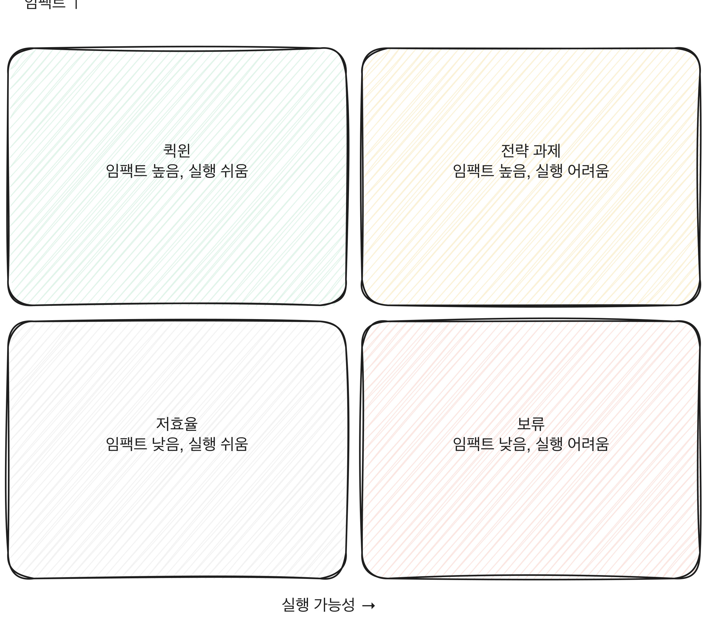

# 3.2 AX 적합도 진단 매트릭스

3.1에서 만든 업무 목록은 아직 평가되지 않은 원재료다. 업무가 많으면 수십, 많은 조직은 수백 개가 쌓인다. 이걸 전부 동시에 검토할 수는 없다. 두 축으로 나눠 좌표 위에 올리면 어디부터 봐야 할지가 눈에 보인다. 이 장은 그 두 축, 임팩트와 실행 가능성을 점수화하는 법을 다룬다.

[그림] 퀵윈부터 손을 대고, 전략 과제는 준비 기간을 따로 잡는다.

## 두 축을 정의한다

**임팩트**는 이 업무를 AI-먼저 구조로 바꿨을 때 회사가 얻는 효과의 크기다. 시간 절감만 보지 않는다. 처리 속도, 오류 감소, 처리 가능한 물량 증가까지 포함한다. 1부에서 다룬 대로, AX의 목표는 AI 사용량이 아니라 회사의 실제 성과이므로, 임팩트는 항상 "이 업무가 빨라지면 회사 성과 지표 중 무엇이 움직이는가"로 답해야 한다. 답이 안 나오면 임팩트 점수를 매기지 않는다.

**실행 가능성**은 지금 당장 착수할 수 있는 정도다. 2부 2.3(어떤 업무가 AI-먼저에 적합한가)에서 세운 적합 기준, 즉 반복성, 데이터 가용성, 오류 허용 범위, 처리 물량 같은 조건을 실행 가능성 점수로 바꾼다.

[그림] 퀵윈부터 손을 대고, 전략 과제는 준비 기간을 따로 잡는다.

## 점수화하는 법

업무마다 두 축을 각각 1에서 5점으로 매긴다. 감으로 매기지 않고 하위 질문에 답한 뒤 합산한다.

**임팩트 (1~5점)**
- 이 업무에 쓰는 시간이 전체 부서 업무 시간의 얼마를 차지하는가
- 이 업무의 결과가 다른 업무나 다른 부서로 전파되는가, 한 곳에서 끝나는가
- 지금 이 업무에서 생기는 오류나 지연이 회사 성과에 드러나는가

**실행 가능성 (1~5점)**
- 이 업무가 매번 비슷한 패턴으로 반복되는가, 매번 다른가
- 이 업무에 필요한 데이터가 지금 시스템에 정리되어 있는가, 사람 머릿속에만 있는가
- 결과물에 오류가 있을 때 되돌릴 수 있는가, 되돌릴 수 없는 피해가 생기는가
- 이 업무를 실제로 하는 사람들이 바뀌는 방식에 동의할 가능성이 있는가

네 질문 중 둘 이상에서 낮은 점수가 나오면 실행 가능성 총점을 낮춘다. 하나가 특히 낮아도 나머지가 높으면 평균으로 상쇄되지 않게, 가장 낮은 항목을 기준으로 깎는다.

## 점수를 매기는 사람을 한 명으로 두지 않는다

점수를 한 사람이 매기면 그 사람의 입장이 그대로 반영된다. 업무를 발주하는 부서장은 임팩트를 높게 매기고, 그 업무를 실제로 바꿔야 하는 실무자는 실행 가능성을 낮게 매기는 경향이 있다. 둘 다 틀린 게 아니라 보는 자리가 다른 것이다. 업무마다 최소 두 사람, 되도록 발주 부서와 실행 부서에서 한 명씩 따로 점수를 매기고, 두 점수가 차이 날 때는 평균을 내지 않는다. 왜 차이가 나는지 짧게 논의하고, 합의가 안 되면 더 낮은 쪽 점수를 쓴다. 매트릭스는 낙관적인 전망을 보여주는 자료가 아니라 착수 여부를 가르는 자료이기 때문이다.

## 매트릭스에 배치한다

가로축을 실행 가능성, 세로축을 임팩트로 놓으면 사분면이 넷 생긴다.

- 임팩트 높고 실행 가능성 높음: 바로 착수할 후보
- 임팩트 높고 실행 가능성 낮음: 준비가 필요한 전략 과제
- 임팩트 낮고 실행 가능성 높음: 작게 해볼 수는 있지만 성과로 보여주기는 어려운 업무
- 임팩트 낮고 실행 가능성 낮음: 지금은 건드리지 않는다

이 사분면 이름과 실제 선택으로 옮기는 법은 3.4에서 다룬다. 이 장에서는 점수를 매겨 좌표를 찍는 데까지만 간다.

사분면 경계에 가깝게 몰리는 업무가 많으면, 그건 척도 자체가 거칠다는 신호다. 1에서 5점으로는 업무 간 차이가 안 드러나는 경우, 하위 질문의 답을 더 세분해서 소수점 하나짜리 가중 평균으로 바꿀 수 있다. 다만 척도를 정교하게 다듬는 데 시간을 너무 쓰지 않는다. 매트릭스의 목적은 정밀한 순위가 아니라 "이 구역은 지금, 저 구역은 나중"을 가르는 것이다.

예를 들어 이런 조직을 가정하면, "고객 문의 1차 답변 작성"이 임팩트 4점, 실행 가능성 4점으로 바로 착수할 후보에 들어가고, "신규 사업 기획안 초안"이 임팩트 5점이지만 실행 가능성 2점(데이터가 흩어져 있고 결과를 되돌리기 어려움)으로 전략 과제 구역에 들어갈 수 있다. 두 업무는 임팩트만 보면 비슷해 보이지만 지금 당장 손댈 업무와 준비가 필요한 업무로 전혀 다르게 분류된다.

> **북마크**
> 업무 하나를 매트릭스에 올리기 전에 던지는 질문 두 개.
> - 임팩트: 이 업무가 빨라지면 회사 성과 지표 중 무엇이 움직이는가. 답이 없으면 점수를 매기지 않는다.
> - 실행 가능성: 반복성, 데이터 가용성, 오류 허용 범위, 사람의 동의 가능성 중 가장 낮은 항목이 전체 점수를 끌어내린다.

## 체크리스트

- [ ] 임팩트 점수를 매길 때 회사 성과 지표와 연결했는가, 체감만으로 매기지 않았는가
- [ ] 실행 가능성 네 질문에 각각 답했는가
- [ ] 가장 낮은 항목이 전체 점수를 끌어내리도록 계산했는가
- [ ] 업무 목록 전체를 매트릭스 위에 좌표로 찍었는가
