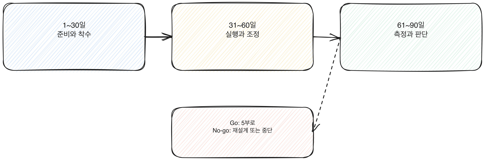

# 4.2 90일 로드맵의 구조

각 파일럿을 90일로 자르는 이유, 그리고 90일을 어떻게 세 블록으로 나누는지가 이 장의 내용이다. 이 구조가 4부 전체, 그리고 5부에서 다룰 2차, 3차 사이클의 뼈대가 된다. 4.1에서 범위와 팀, 성공 기준을 정했다면, 이 장은 그 파일럿을 90일 안에 어떤 순서로 돌릴지 보여주는 설계도다.

[그림] 세 번째 블록 끝에서 Go, No-go를 가른다.

## 왜 90일인가

90일은 통계에서 나온 숫자가 아니라 이 책이 설계한 틀이다. 기준은 세 가지다.

- 한 분기 보고 주기와 맞아서, 경영진에게 중간 결과를 보고할 자연스러운 시점이 생긴다.
- 바뀐 업무 방식이 익숙해지는 데 걸리는 최소 시간을 확보하면서도, 익숙해진 뒤 결과를 볼 시간이 남는다.
- 90일 안에 끝나지 않는 파일럿은 범위가 너무 크다는 뜻이고, 그 자체가 신호다. 4.1에서 다룬 범위 좁히기로 돌아가야 한다.

90일을 절대 넘기면 안 된다는 규칙은 아니다. 90일을 기준점으로 두고, 그 안에서 못 끝나면 범위를 다시 보라는 신호로 쓴다.

업무 성격에 따라 세 블록의 길이를 30일씩 똑같이 나누기 어려울 수도 있다. 예를 들어 승인 절차가 긴 업무를 가정하면 준비 블록이 30일을 넘길 수 있다. 이런 경우 전체 기간을 늘리기보다, 4.1에서 다룬 범위 좁히기로 돌아가 승인 절차 자체를 파일럿 범위 밖으로 빼는 쪽을 먼저 검토한다. 구조를 지키는 쪽이 기간을 늘리는 쪽보다 낫다.

[그림] 90일 안에 못 끝나면 범위가 너무 크다는 신호다.

## 세 블록의 구조

90일을 30일씩 세 블록으로 나눈다. 블록마다 묻는 질문과 끝날 때 남아야 할 결과물이 다르다.

| 블록 | 기간 | 핵심 질문 | 끝날 때 남는 것 |
|---|---|---|---|
| 준비/착수 | 1~30일 | 팀과 도구, 기준선이 준비됐는가 | 베이스라인 수치, 교육을 마친 참여자 |
| 실행/조정 | 31~60일 | 실제로 쓰고 있는가, 막히는 지점은 어디인가 | 중간 점검 기록, 조정한 내용 |
| 측정/판단 | 61~90일 | 베이스라인과 비교해 무엇이 달라졌는가 | Go/No-go 판단, 다음 단계 제안 |

세 블록은 순서대로 진행하지만 완전히 분리되지는 않는다. 준비 블록에서 측정 방법을 정하지 않으면 측정 블록에서 비교할 기준이 없고, 실행 블록에서 기록을 안 남기면 측정 블록에서 무엇이 달라졌는지 재구성할 수 없다. 블록은 순서이자 동시에 서로에게 재료를 넘기는 관계다.

4.1에서 파일럿을 둘까지 허용했다면, 두 파일럿의 블록 경계를 같은 날짜로 맞춘다. 한 파일럿은 1월 1일에, 다른 파일럿은 1월 15일에 시작하면 전환점 회의가 따로 두 번 생기고, 팀이 겹치는 경우 일정이 부딪힌다. 둘을 같은 날 시작해서 같은 날 30일차를 맞도록 짜 두면 전환점 회의도 한 번에 묶을 수 있다.

> **북마크**
> 90일 로드맵 3블록 구조
> 1~30일 준비/착수 — 팀, 도구, 베이스라인
> 31~60일 실행/조정 — 적용, 중간 점검, 조정
> 61~90일 측정/판단 — 비교, Go/No-go
> 각 블록의 세부 내용은 4.3, 4.4, 4.5에서 다룬다

## 블록 사이의 전환점

블록이 바뀌는 시점, 30일차와 60일차에 짧은 점검 회의를 둔다. 다음 블록으로 넘어갈 준비가 됐는지 확인하는 자리이지, 중간 평가를 발표하는 자리가 아니다. 30일차에 베이스라인이 없으면 실행 블록으로 못 넘어간다. 60일차에 중간 점검 기록이 없으면 측정 블록에서 비교할 게 없다. 전환점을 놓치면 다음 블록이 그 구멍을 안고 시작한다.

전환점 회의는 팀 전체를 다 모을 필요가 없다. 4.1에서 정한 결정 권한자와 실행을 맡은 담당자 몇 명이면 충분하다. 회의 안건은 하나다. 다음 블록으로 넘어갈 조건이 채워졌는가. 채워졌으면 바로 다음 블록으로 넘어가고, 안 채워졌으면 무엇이 비었는지 그 자리에서 정하고 날짜를 못박는다. 전환점을 길게 끌면 90일이라는 전체 틀의 의미가 흐려진다.

## 이 구조가 5부, 8부와 이어지는 지점

이 장에서 쓴 3블록 구조는 4부에서 한 번 쓰고 끝나지 않는다. 5.2 2차, 3차 90일 사이클 설계에서는 같은 구조를 반복하면서 매 사이클 베이스라인을 갱신한다. 8.1 90일 로드맵 양식 작성법에는 이 표를 그대로 옮긴 양식이 있다. 이 장을 다시 펼칠 일이 생기면, 표와 북마크만 다시 보면 된다.

## 체크리스트

- [ ] 90일을 세 블록으로 나누고 각 블록이 끝날 때 남을 결과물을 미리 정했는가
- [ ] 30일차, 60일차 전환점에 점검 회의를 일정에 넣었는가
- [ ] 90일 안에 끝나지 않을 것 같으면 범위를 다시 좁힐 계획이 있는가
