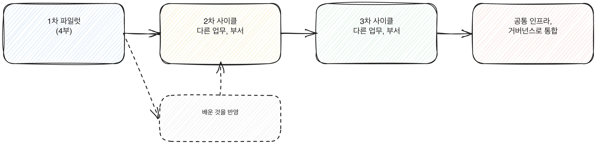

# 5.2 2차, 3차 90일 사이클 설계

확산은 한 번에 전사로 켜는 일이 아니다. 같은 90일 구조를 다른 부서나 다른 업무에 반복해서 적용하는 일이다. 1차 파일럿이 5.1의 기준을 통과했다면, 다음 단계는 그 구조를 복사해서 두 번째 사이클을 도는 것이다. 이 장은 2차, 3차 사이클을 어떻게 설계하는지, 1차에서 배운 것을 어떻게 반영하는지를 다룬다.

[그림] 사이클마다 배운 것을 다음 사이클 착수 전에 반영한다.

## 1차에서 배운 것을 가져온다

1차 파일럿을 거치면서 쌓인 것은 결과 수치만이 아니다. 어떤 질문에 시간이 많이 들었는지, 어느 단계에서 담당자가 자주 멈췄는지, 어떤 데이터 형식이 예상과 달랐는지 같은 운영 지식이 함께 쌓인다. 이 지식을 2차 사이클에 반영하지 않으면 매번 같은 실수를 다시 겪는다.

가져올 것은 세 가지로 나뉜다. 매뉴얼과 템플릿처럼 그대로 재사용할 수 있는 것, 1차에서 막혔던 지점을 미리 피하도록 고친 절차, 그리고 1차에서는 몰랐지만 이제는 체크리스트에 넣을 수 있는 위험 신호다. 4.6에서 다룬 실패 신호 목록이 있다면 2차 사이클의 출발점에 그대로 붙인다.

이 세 가지를 모으는 자리는 1차 사이클이 끝난 직후, 2차 사이클을 설계하기 전이어야 한다. 시간이 지나면 담당자가 겪은 구체적인 어려움은 흐릿해지고 결과 수치만 남는다. 1차 사이클의 61~90일 구간, 곧 4.5에서 다룬 측정과 판단 단계에 "다음 사이클에 넘길 메모"를 별도로 쌓아 두면 이 작업이 수월해진다.

[그림] 1차에서 막혔던 지점을 2차 착수 전에 먼저 치운다.

## 사이클마다 달라지는 것

2차 사이클의 대상은 보통 다른 부서거나 다른 업무 유형이다. 담당자도 다르고, 업무가 다루는 데이터나 고객 접점도 다르다. 이 차이를 1차와 똑같이 취급하면 5.1에서 경고한 조건 의존성 문제가 그대로 반복된다. 2차 사이클을 시작할 때는 "이번 대상이 1차와 다른 점이 무엇인가"를 먼저 적어 두고, 그 차이가 재설계 구조에 어떤 조정을 요구하는지 미리 짚는다.

사이클을 반복할수록 1차에서 겪었던 조직 내부의 낯섦은 줄어든다. "이게 뭔지부터 설명해야 하는" 단계가 짧아지고, 그만큼 같은 90일 안에서 실행에 쓸 수 있는 시간이 늘어난다. 이 여유를 새로운 위험을 더 꼼꼼히 보는 데 쓴다. 속도를 더 내는 데만 쓰면 2차 사이클이 1차보다 더 거칠게 끝난다.

예를 들어 1차 사이클이 고객 응대 업무를 다뤘고 2차 사이클이 내부 보고서 작성 업무를 다룬다고 가정하면, 두 업무는 검토가 필요한 이유도 다르고 실수가 드러나는 방식도 다르다. 1차에서 쓴 검토 체크리스트를 그대로 옮기면 빠진 항목이 생긴다. 2차 사이클을 설계하는 첫 회의는 매뉴얼을 복사하는 자리가 아니라, 그 매뉴얼의 각 항목이 새 업무에도 그대로 성립하는지 하나씩 확인하는 자리여야 한다.

> **북마크**
> 2차, 3차 사이클을 시작할 때 확인하는 질문.
> - 1차에서 쌓은 매뉴얼, 체크리스트, 실패 신호 목록을 이번 사이클에 그대로 가져왔는가
> - 이번 대상이 1차와 다른 점을 먼저 적었는가
> - 90일 구조, 측정 지표, 판단 기준(Go/No-go)은 1차와 같은 틀을 유지하고 있는가

## 바뀌지 않아야 하는 것

사이클마다 바뀌는 것이 있는 만큼, 바뀌지 않아야 하는 것도 있다. 90일이라는 기간, 30일 단위로 준비, 실행, 측정을 나누는 구조, Go/No-go를 판단하는 기준선은 사이클마다 다시 설계하지 않는다. 이 틀을 사이클마다 다르게 가져가면 사이클 간 결과를 비교할 수 없게 되고, 확산 전체가 몇 번째 사이클인지도 모르는 상태로 흩어진다. 틀은 고정하고 내용만 그 부서에 맞게 채운다.

## 사이클 수가 늘어날수록 관리 단위가 바뀐다

1차, 2차 사이클까지는 담당자가 각 사이클의 내용을 머릿속으로 다 파악할 수 있다. 3차, 4차로 넘어가면 동시에 여러 사이클이 각기 다른 단계에서 진행되는 상황이 온다. 한 사이클은 61~90일 측정 단계에 있고, 다른 사이클은 1~30일 착수 단계에 있는 식이다. 이 시점부터는 사이클 하나하나를 보는 것이 아니라, 전체 사이클을 한 장에 모아 어느 사이클이 어느 단계에 있는지 보여주는 현황판이 필요해진다. 8부에서 다루는 로드맵 양식을 사이클 단위로 나란히 쓰면 이 역할을 한다.

## 체크리스트

- [ ] 1차 파일럿에서 나온 매뉴얼과 실패 신호 목록을 문서로 정리해 2차 사이클 담당자에게 전달했는가
- [ ] 1차 매뉴얼의 각 항목이 2차 사이클 업무에도 그대로 성립하는지 하나씩 확인했는가
- [ ] 90일 구조와 판단 기준을 사이클마다 임의로 바꾸지 않기로 합의했는가
- [ ] 동시에 진행되는 사이클이 둘 이상이라면 각 사이클의 단계를 한눈에 보는 현황판이 있는가
