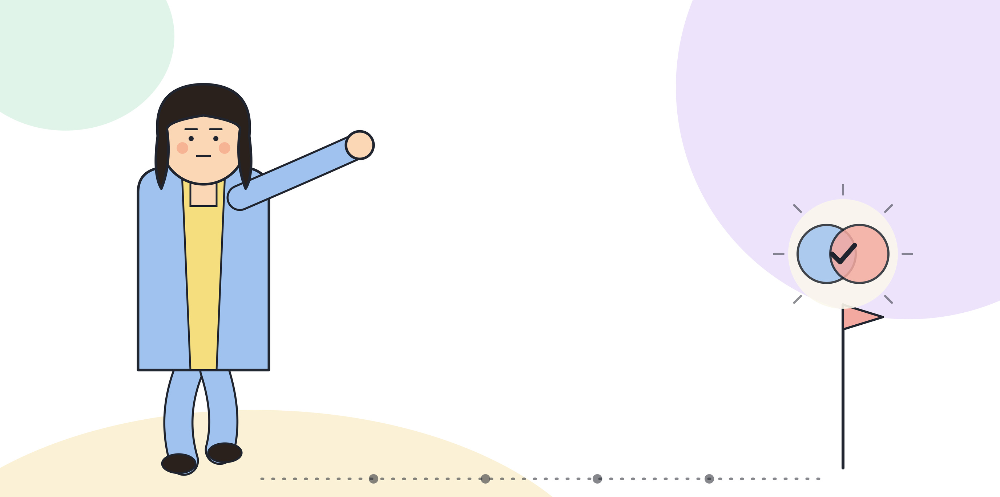

# 5.3 부서 간 전파: 저항을 다루는 법

파일럿이 성공하고 2차, 3차 사이클까지 설계를 마쳤다고 해도, 다음 부서가 자동으로 받아들이지는 않는다. 확산 단계에서 겪는 저항은 파일럿 단계의 저항과 성격이 다르다. 파일럿 단계의 저항은 "이게 될지 모르겠다"는 의심이었다면, 확산 단계의 저항은 "이게 되는 건 알겠는데 우리 쪽에는 맞지 않는다"는 거절이다. 증거가 이미 있는데도 막힌다는 점에서 다루기가 더 까다롭다.

## 저항의 유형 1: "그건 다른 팀 얘기다"

가장 흔한 반응이다. 파일럿이 성공한 부서와 지금 설득하려는 부서 사이의 차이를 근거로, 그 성공이 자기 부서와는 무관하다고 선을 긋는다. 이 반응에는 절반의 진실이 있다. 5.1에서 다룬 대로 파일럿의 조건은 실제로 부서마다 다르다. 문제는 차이가 있다는 사실 자체를 "그러니 적용할 수 없다"는 결론으로 바로 건너뛰는 데 있다.

이 저항을 다루는 방법은 차이를 부정하지 않는 것이다. 대신 그 차이가 재설계 구조의 어느 부분을 조정해야 하는지로 질문을 바꾼다. "다른 팀 얘기다"에서 "우리 팀에 맞게 어디를 바꿔야 하는가"로 옮기면, 거절할 이유를 찾던 대화가 조정할 항목을 찾는 대화로 바뀐다.

이 전환이 말로만 되지는 않는다. 질문을 바꾸려면 손에 쥘 수 있는 것이 있어야 한다. 3부의 적합도 매트릭스를 그 부서 업무에 직접 적용한 결과표를 들고 가면, "다른 팀 얘기다"라는 반응은 추상적인 반박이 아니라 매트릭스의 특정 항목을 지적하는 구체적인 반응으로 바뀐다. 구체적인 반응은 다룰 수 있다. 추상적인 거절은 다룰 수 없다.

[그림] 저항은 설득이 아니라 그들의 업무 언어로 옮겨야 풀린다.

## 저항의 유형 2: 기존 방식에 대한 애착

오래 손에 익은 방식을 바꾸는 데는 비용이 든다. 숙련도를 다시 쌓아야 하고, 그동안 쌓은 노하우 일부가 쓸모없어진다. 이 저항은 비합리적인 것이 아니라 손실에 대한 합리적인 반응이다. 애착이 강한 구성원일수록 보통 그 업무에 가장 숙련된 사람이다. 이 사람을 설득하지 못하면 그 부서 안에서 확산이 멈춘다.

이 저항을 다루려면 기존 방식을 깎아내리지 않는다. 대신 재설계된 구조에서 그 사람의 숙련도가 어디로 옮겨 가는지를 구체적으로 보여준다. 2부에서 다룬 "AI가 먼저, 사람이 검토" 구조에서는 검토와 판단이 사람의 역할로 남는다. 숙련도가 사라지는 것이 아니라 적용되는 자리가 바뀐다는 점을 분명히 한다.

이 설명이 통하지 않는 경우도 있다. 그 사람의 숙련도 대부분이 지금 AI가 먼저 처리하게 될 작업, 예를 들어 반복적인 초안 작성이나 정형화된 집계에 쏠려 있었던 경우를 가정하면, 검토로 옮겨 가는 몫이 그 사람이 느끼기에 작을 수 있다. 이때는 역할이 줄어든다는 사실을 돌려 말하지 않는다. 대신 그 사람의 숙련도 중 검토와 판단에 쓸 수 있는 부분을 구체적으로 짚어 보여주고, 나머지는 6부에서 다루는 역할 재설계와 교육으로 이어지는 문제라고 정직하게 알린다.

## 저항의 유형 3: "우리 업무는 다르다"는 예외주의

유형 1과 비슷하지만 더 단정적이다. 차이를 조정할 여지가 있는 것으로 보지 않고, 자기 부서의 업무가 구조적으로 예외라고 못 박는다. 이 주장이 맞을 때도 있다. 2부에서 다룬 적합 기준을 적용했을 때 실제로 AI-먼저 구조에 맞지 않는 업무도 있다. 그래서 이 저항에는 먼저 진단으로 답한다. 3부의 적합도 매트릭스를 그 부서 업무에 직접 적용해서, 예외라는 주장이 진단 결과로 확인되는지 본다.

진단 결과가 실제로 예외를 뒷받침한다면, 그 부서를 억지로 끼워 넣지 않는다. 확산은 모든 부서에 같은 구조를 강제하는 일이 아니라, 맞는 곳에 맞는 구조를 넓히는 일이다. 반대로 진단 결과가 예외를 뒷받침하지 않는데도 같은 주장이 반복된다면, 그 저항은 업무의 성격이 아니라 다른 자리, 보통 유형 2의 애착이나 평가 변화에 대한 불안에서 나온다고 보고 접근을 바꾼다.

> **북마크**
> 저항을 다루는 공통 원칙.
> - 차이를 부정하지 않는다. "다르다"는 주장을 "어디를 조정해야 하는가"로 바꾼다
> - 기존 방식에 대한 애착은 손실에 대한 반응으로 보고, 숙련도가 어디로 옮겨 가는지 구체적으로 보여준다
> - "우리는 예외다"라는 주장은 설득이 아니라 진단으로 확인한다

## 체크리스트

- [ ] 다음 확산 대상 부서의 저항이 세 유형 중 어디에 가까운지 파악했는가
- [ ] 저항 근거로 쓸 적합도 매트릭스 결과표를 그 부서 업무로 직접 만들어 보았는가
- [ ] 기존 업무에 가장 숙련된 구성원에게 숙련도가 어디로 옮겨 가는지 구체적으로 설명했는가
- [ ] "우리는 예외다"라는 주장을 적합도 매트릭스로 직접 확인해 보았는가
