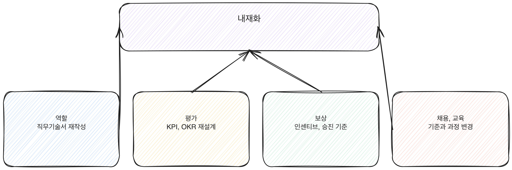

# 6.2 역할을 다시 정의한다

AI-먼저 구조로 일한 지 반 년이 지난 팀에 직무기술서를 보여 달라고 하면, 대개 2부에서 재설계하기 전 내용이 그대로 남아 있다. "시장 조사 보고서를 작성한다", "고객 문의에 응답한다"는 식으로 적혀 있고, 그 작업을 AI가 먼저 처리하고 사람이 검토, 결정한다는 사실은 어디에도 안 적혀 있다. 직무기술서가 안 바뀌었다는 건 조직이 아직 그 역할을 예전 방식으로 인식한다는 뜻이다. 인식이 그대로면 평가도, 채용도 그 인식을 따라간다.

[그림] 기둥 하나가 비면 내재화 전체가 흔들린다.

## 직무기술서가 늦게 바뀌는 이유

업무 방식이 바뀌어도 직무기술서는 보통 뒤에 남는다. 직무기술서를 고치는 일은 눈에 보이는 성과가 아니고, 인사 부서와 현업 부서 양쪽의 승인이 필요해서 느리다. 그래서 파일럿과 확산 단계에서는 "일단 이렇게 일해 보자"로 넘어가고, 직무기술서는 나중으로 미뤄진다. 문제는 그 "나중"이 오지 않는다는 것이다. 미룬 채로 담당자가 바뀌면, 후임은 직무기술서에 적힌 옛 방식을 기준으로 업무를 배운다.

[그림] 한 줄 추가로는 아무것도 바뀌지 않는다.

## 다시 쓰는 법: 작업 단위로 내려가기

직무기술서를 다시 쓸 때 "AI를 활용하여 업무를 수행한다"처럼 한 줄만 추가하는 경우가 많다. 이 문장은 아무것도 바꾸지 않는다. 구체적으로 내려가야 한다. 2부에서 다룬 업무 분해 방식을 그대로 가져온다. 업무를 작업 단위로 쪼개고, 각 작업에서 AI가 1차 결과를 만드는지, 사람이 그 결과를 검토만 하는지, 아니면 사람이 처음부터 끝까지 판단하는지를 명시한다.

가정해 보면, 어느 조직의 콘텐츠 기획 역할이 이렇게 바뀔 수 있다. 예전 직무기술서는 "콘텐츠 기획안을 작성한다"였다. 다시 쓰면 "주제별 1차 기획안은 AI가 생성하고, 담당자는 기획안의 방향성과 리스크를 검토해 승인 또는 반려하며, 승인된 기획안의 최종 책임은 담당자에게 있다"가 된다. 이 문장에는 AI가 하는 일, 사람이 하는 일, 결정권이 누구에게 있는지가 전부 들어 있다.

## 새 직함을 만드는 것과 기존 역할을 고치는 것

역할을 다시 정의한다고 하면 "AI 오케스트레이터", "AI 협업 매니저" 같은 새 직함을 만드는 쪽으로 먼저 눈이 간다. 새 직함은 눈에 띄고 보고하기도 쉽지만, 조직 전체의 역할을 바꾸는 효과는 크지 않다. 대부분의 구성원은 새 직함을 받는 소수가 아니라 기존 역할을 그대로 유지하는 다수이기 때문이다. 내재화의 핵심은 이 다수가 맡은 기존 역할, 즉 기획자, 분석가, 상담 담당자, 개발자 같은 직무기술서를 고치는 데 있다. 새 직함은 조직이 AI-먼저 구조를 전담하는 역할을 따로 두기로 판단했을 때만 추가하고, 그 경우에도 기존 역할의 직무기술서를 손대는 작업을 대신하지 않는다.

4부에서 다룬 파일럿 단계의 역할은 보통 임시로 정의된다. "이번 90일 동안 이 작업은 담당자가 직접 검토한다"는 식으로 기간을 전제로 적는다. 내재화 단계에서는 이 임시 정의에서 기간 조건을 떼어내고 상시 직무기술서로 옮겨야 한다. 파일럿 문서를 그대로 둔 채 확산만 하면, 조직 어딘가에는 "임시"라는 전제가 붙은 역할 정의가 계속 남아 있고, 그 전제는 누군가 이의를 제기하는 순간 되돌릴 근거로 쓰인다.

## 결정권 문구를 빠뜨리지 않는다

역할을 다시 쓸 때 가장 자주 빠지는 부분이 결정권 문구다. "AI가 1차 결과를 만들고 사람이 검토한다"까지만 적으면, 검토 후 최종 책임이 누구에게 있는지가 불분명해진다. 책임이 불분명한 역할은 문제가 생겼을 때 "AI가 그렇게 했다"는 식으로 책임을 떠넘기는 통로가 된다. 2부 2.4에서 다룬 검토와 결정권 설계를 역할 정의 문서에 그대로 옮겨 적어야 하는 이유다.

> **북마크**
> 직무기술서를 다시 쓸 때 확인할 항목 네 가지.
> - 이 역할의 작업 중 AI가 1차로 처리하는 작업이 무엇인지 명시했는가
> - 사람이 검토만 하는 작업과 처음부터 판단하는 작업을 구분했는가
> - 최종 결정과 책임이 누구에게 있는지 문구로 적었는가
> - 이 문구를 인사 부서의 직무기술서 양식에 실제로 반영했는가, 현업에서만 통용되는 구두 설명으로 남겨두지 않았는가

## 체크리스트

- [ ] 현재 운영 중인 역할의 직무기술서가 AI-먼저 구조를 반영하고 있는지 확인했는가
- [ ] 역할별로 AI가 처리하는 작업과 사람이 검토, 결정하는 작업을 구분해서 적었는가
- [ ] 수정한 직무기술서를 인사 부서의 공식 양식에 반영했는가
