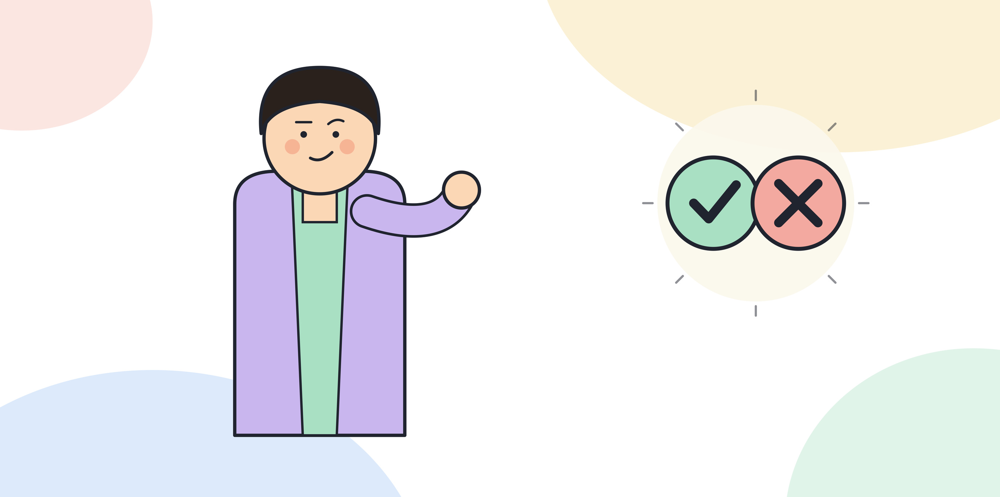

# 6.8 내재화가 끝났다는 것을 어떻게 아는가

내재화는 확산과 달라서 "완료"라고 선언할 수 있는 뚜렷한 종료 시점이 없다. 역할, 평가, 보상, 채용, 교육을 한 번씩 고쳤다고 끝이라고 보기도 어렵다. 6.1에서 짚었듯 조직은 시간이 지나면 다시 예전 제도로 돌아가려는 힘을 받기 때문에, 내재화는 한 번의 작업이 아니라 계속 점검해야 하는 상태에 가깝다. 그래도 지금 어디까지 왔는지 판단할 기준은 필요하다. 이 장에서는 그 기준을 다섯 갈래별로 정리한다.

## 다섯 갈래를 각각 점검한다

가장 단순한 확인 방법은 6.2부터 6.6까지 다룬 다섯 갈래를 하나씩 짚어보는 것이다. 역할 정의가 AI-먼저 구조를 명시하고 있는가, 평가지표가 사용량이 아니라 성과를 가리키는가, 보상이 그 지표를 따라가는가, 채용 기준과 면접 과제가 검토 역량을 묻는가, 교육과 온보딩 자료가 최신 역할 정의를 반영하는가. 다섯 질문 중 몇 개에 답이 "아니다"면, 그 갈래부터 다시 손댄다. 전부 "그렇다"로 답할 수 있다고 해서 영구히 끝난 것은 아니지만, 적어도 지금 시점에서는 제도가 구조를 지탱하고 있다는 뜻이다.

이 점검은 인사 부서 혼자 할 일도, 현업 부서 혼자 할 일도 아니다. 인사 부서는 제도가 문서상으로 바뀌었는지를 보고, 현업 부서는 그 제도가 실제 업무에서 쓰이고 있는지를 본다. 두 쪽의 판단이 다르면, 즉 서류는 바뀌었는데 현업에서는 예전 방식이 그대로 돌아가고 있다면 아직 끝나지 않은 것이다.

[그림] 담당자가 바뀌어도 방식이 그대로면 내재화가 끝난 것이다.

## 가장 확실한 신호: 사람이 바뀌어도 유지되는가

다섯 갈래를 서류상으로 다 고쳤어도, 가장 신뢰할 수 있는 확인 방법은 실제로 사람이 바뀌는 상황을 지켜보는 것이다. 핵심 담당자가 휴가를 가거나 다른 부서로 옮기거나 퇴사했을 때, 업무가 그 구조를 유지한 채로 돌아가는지 본다. 신규 입사자가 온보딩만으로 역할을 이해하고 업무에 들어가는지, 아니면 선임에게 따로 구두 설명을 들어야 하는지도 같은 신호다. 사람이 바뀌어도 설명 없이 유지되면 내재화됐고, 사람이 바뀌는 순간 흔들리면 아직 특정 인물에게 의존하고 있다는 뜻이다.

## 부분적으로 끝났을 때 판단하는 법

실제로는 다섯 갈래가 동시에 완료되는 경우가 드물다. 평가지표는 바뀌었는데 보상은 아직 과도기 기준을 쓰고 있거나, 역할과 교육은 정리됐는데 채용 기준만 아직 손대지 못한 상태가 흔하다. 이런 부분적 상태를 두고 "아직 내재화가 안 됐다"고만 판단하면 진행 상황을 가늠하기 어렵다. 다섯 갈래 중 몇 개가 끝났는지를 세고, 남은 갈래에 누가 언제까지 손댈지를 정하는 쪽이 더 쓸모 있다. 6.7에서 다룬 경영진의 정기 점검 자리가 바로 이 상태를 확인하는 자리다.

## 내재화 이후에 할 일

내재화가 어느 수준에 이르렀다고 판단되면, 조직의 관심은 자연스럽게 다음 사이클로 넘어간다. 5부에서 다룬 2차, 3차 확산 사이클이 돌아가면서 AI-먼저 구조로 재설계할 업무 범위가 계속 늘어나고, 그때마다 역할과 평가가 다시 조정될 필요가 생긴다. 내재화는 이 조정이 매번 큰 공사가 되지 않도록, 제도를 고치는 절차 자체를 가볍게 만들어 두는 작업이기도 하다. 처음 내재화할 때 역할과 평가를 고치는 과정을 문서로 정리해 두면, 다음 사이클에서는 그 절차를 반복하면 된다.

> **북마크**
> 내재화 완료를 판단하는 다섯 갈래 점검표.
> - 역할 정의가 AI-먼저 구조를 명시하고 있는가
> - 평가지표가 사용량이 아니라 성과를 가리키는가
> - 보상이 그 성과 지표를 따라가는가
> - 채용 기준과 면접 과제가 검토 역량을 묻는가
> - 교육과 온보딩 자료가 최신 역할 정의를 반영하는가
> - 핵심 담당자가 바뀌어도 구조가 구두 설명 없이 유지되는가

## 체크리스트

- [ ] 다섯 갈래를 각각 짚어보고 아직 손대지 못한 부분을 확인했는가
- [ ] 핵심 담당자가 자리를 비우는 상황을 가정해 구조가 유지되는지 점검했는가
- [ ] 내재화 절차를 문서로 남겨 다음 확산 사이클에서 반복할 수 있게 했는가
