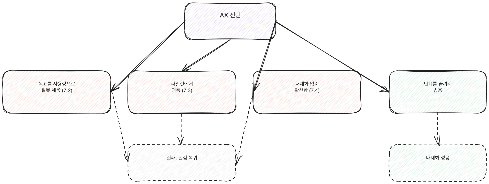

# 7.1 AX 전환이 실패하는 전형적인 경로

AX 전환이 멈췄다는 보고를 받으면 대개 마지막에 터진 사건을 원인으로 지목한다. 담당자가 퇴사했다, 예산이 끊겼다, 경영진의 관심이 식었다. 이런 사건은 결과에 가깝다. 원인을 거슬러 올라가면 네 번의 분기점 중 하나에서 길이 갈라진 지점이 나온다. 이 장은 그 네 분기점을 순서대로 정리한다. 다음 세 장(7.2~7.4)은 이 분기점 중 세 개를 가상 사례로 풀어서 보여준다.

[그림] 세 분기 모두 같은 곳, 실패와 원점 복귀로 모인다.

## 분기점 1: 목표를 잘못 세운다 (1부)

첫 분기는 가장 앞에 있고, 그래서 가장 멀리까지 영향을 미친다. AX의 목표를 AI 사용량, 즉 라이선스 배포 수나 사용률로 잡으면 그 다음에 하는 모든 일이 틀린 목표를 더 정교하게 달성하는 작업이 된다. 사용량은 올라가지만 처리 시간이나 품질 같은 실제 성과는 그대로다. 이 간극이 드러나는 데는 시간이 걸리고, 드러났을 때는 이미 여러 부서가 "AI를 쓰고 있다"는 보고를 반복한 뒤다. 되돌리려면 목표 문서 자체를 다시 써야 하는데, 이미 보고된 숫자를 뒤집는 결정은 조직 안에서 내리기 어렵다. 이 분기점에서 길이 갈렸다는 신호는 보고 자료에 있다. 성과 지표 없이 사용량 지표만 분기별로 올라가는 그래프가 반복해서 올라온다면, 이미 이 분기점을 지나친 것이다.

[그림] 마지막에 터진 사건은 결과이지, 원인은 더 앞에 있다.

## 분기점 2: 파일럿에서 멈춘다 (4부)

목표를 제대로 세웠어도 파일럿이 확산으로 이어지지 못하는 지점에서 두 번째 분기가 생긴다. 파일럿 자체는 성공으로 끝난다. 90일 로드맵을 지켰고, 측정 지표도 개선됐다. 문제는 그 다음이다. 확산 계획을 파일럿 설계 단계에서 같이 짜 두지 않으면, 성공 보고서만 남고 다음 조직으로 넘길 체계는 없는 상태가 된다. 파일럿을 이끈 담당자가 다른 업무로 돌아가면 그 지식도 함께 사라진다. 이 분기점의 신호는 파일럿 종료 후 회의록에 있다. "다음 분기에 확대 검토"라는 문구만 반복되고 구체적인 담당 조직과 일정이 없다면, 이미 고착이 시작된 것이다.

## 분기점 3: 무분별하게 확산한다 (5부)

파일럿이 성공하면 반대 방향의 위험이 생긴다. 검증된 속도보다 빠르게, 검증되지 않은 범위까지 한꺼번에 밀어붙이는 것이다. 5부에서 다루는 확산 기준과 사이클 설계를 건너뛰고 "전사 적용"을 선언하면, 공통 인프라와 거버넌스가 갖춰지기 전에 수십 개 부서가 각자 다른 방식으로 AI를 쓰게 된다. 이 상태는 겉보기에 확산처럼 보이지만 실제로는 통제를 잃은 것에 가깝다. 이 분기점의 신호는 문의 창구에 쌓인다. 같은 질문("우리 부서는 어떤 도구를 써야 하나요")이 여러 부서에서 서로 다른 답을 들고 반복된다면, 공통 인프라와 거버넌스보다 확산 속도가 앞서 간 상태다.

## 분기점 4: 내재화에 실패한다 (6부)

확산까지 순조로웠어도 역할, 평가, 보상이 바뀌지 않으면 마지막 분기에서 무너진다. 사람들은 새 업무 구조를 처음 몇 달은 따르지만, 평가 기준과 보상이 예전 방식 그대로면 결국 예전 방식으로 돌아간다. 열기가 식는 속도는 확산 속도보다 훨씬 빠르다. 이 분기점의 신호는 채용 공고와 평가표에 있다. AX 도입을 선언한 지 한참 지났는데도 직무 기술서와 평가 항목이 바뀌지 않았다면, 조직은 이미 이 분기점에서 옛길로 들어선 상태다.

## 네 분기점이 하나로 이어지는 이유

이 네 갈래는 독립된 사고가 아니라 순서를 이룬다. 앞 분기점에서 길을 잘못 들면 뒤 분기점에서 고칠 여지가 줄어든다. 목표를 잘못 세운 조직은 파일럿 설계부터 틀린 지표를 좇고, 파일럿에서 멈춘 조직은 확산 압박을 받을 때 검증 없이 범위만 넓히려는 유혹에 빠지고, 무분별하게 확산한 조직은 내재화를 할 여력도 순서도 잃는다. 그래서 이 책은 7부를 맨 마지막 실행 장으로 두고, 1부부터 6부까지의 순서를 거슬러 올라가며 어디서 길이 갈렸는지 되짚게 만든다.

> **북마크**
> 지금 우리 조직이 어느 분기점에 서 있는지 가늠하는 질문 네 가지.
> - 목표 문서의 숫자가 사용량인가, 성과인가 (분기점 1)
> - 파일럿이 끝난 뒤 확산 계획과 담당 조직이 문서로 남아 있는가 (분기점 2)
> - 지금의 확산 범위가 검증된 속도를 넘어서고 있는가 (분기점 3)
> - 평가와 보상 기준이 새 업무 구조에 맞게 바뀌었는가 (분기점 4)

## 체크리스트

- [ ] 우리 조직의 AX 전환이 멈췄거나 정체된 지점이 네 분기점 중 어디인지 짚었는가
- [ ] 그 분기점 이전 단계(1부, 4부, 5부, 6부 중 해당 부)의 점검 기준으로 되돌아가 확인했는가
- [ ] 다음 세 장의 가상 사례 중 우리 상황과 가장 비슷한 사례를 먼저 읽을 계획을 세웠는가
